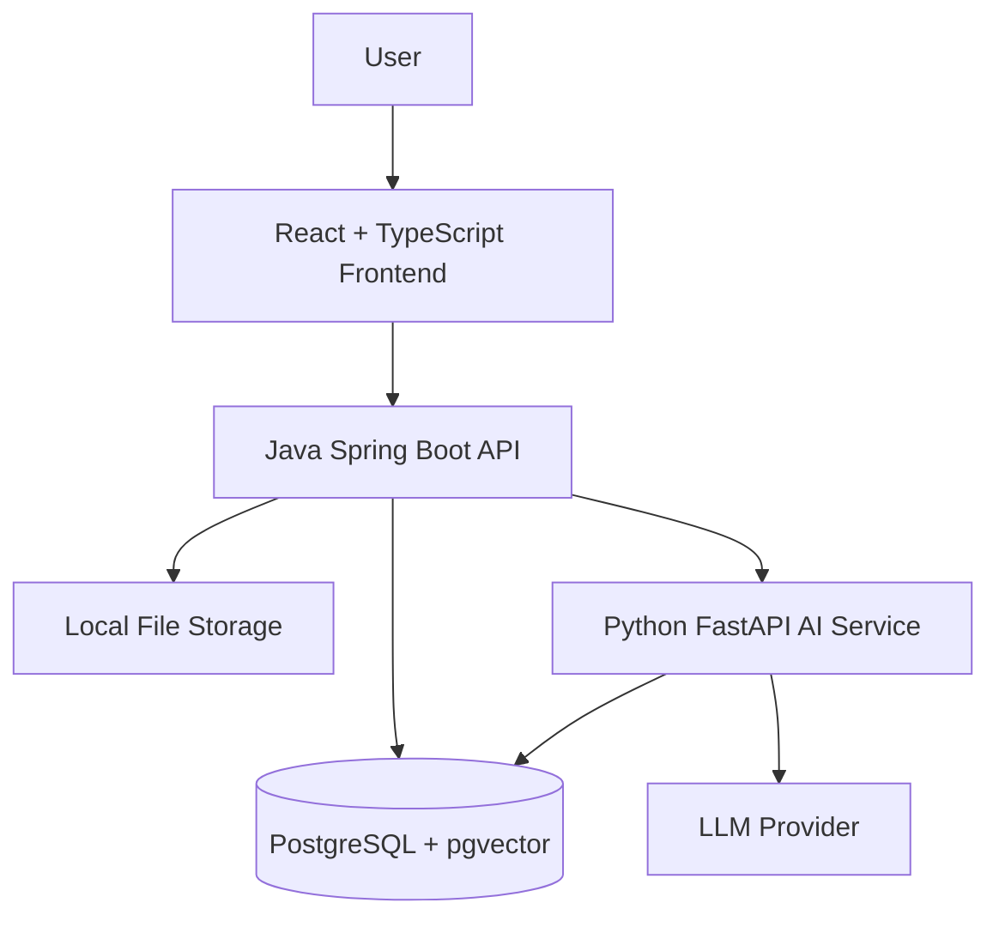

# DocuMind: Enterprise Document Intelligence Platform

> A planned enterprise document intelligence platform that helps teams search documents, ask questions with verifiable citations, extract structured information, and perform evidence-based compliance checks.


**Repository:** [palaks859/DocuMind](https://github.com/palaks859/DocuMind)

**Project status:** Phase 0 — Design and Planning

> **Development status:** The repository currently contains initial planning documentation and project structure. Application features, automated tests, deployment, and evaluation results have not yet been implemented or verified.

> **Data policy:** The project is intended to use public or synthetic documents for development and evaluation. Do not upload confidential or personal information.

---

## Table of Contents

1. [Problem Statement](#problem-statement)
2. [Project Objectives](#project-objectives)
3. [Planned Features](#planned-features)
4. [System Architecture](#system-architecture)
5. [Technology Stack](#technology-stack)
6. [Planned Workflow](#planned-workflow)
7. [Security and Privacy](#security-and-privacy)
8. [Evaluation Plan](#evaluation-plan)
9. [Project Structure](#project-structure)
10. [Getting Started](#getting-started)
11. [Development Roadmap](#development-roadmap)
12. [Future Scope](#future-scope)
13. [Author](#author)
14. [License](#license)

---

## Problem Statement

Organizations store important knowledge in unstructured documents such as contracts, policies, regulations, manuals, and audit reports.

Finding specific information across these documents can be time-consuming and error-prone. Compliance reviewers may need to examine many documents manually to verify clauses and obligations. General-purpose AI systems can generate unsupported answers and may not provide reliable source references.

Document access and activity tracking also require careful control when multiple users work with sensitive information.

**DocuMind aims to address these challenges** through document search, evidence-grounded question answering, structured extraction, compliance checks, role-based access control, and audit logging.

## Project Objectives

The project aims to:

- Enable users to ask questions about authorized documents in natural language.
- Return answers supported by source documents, page numbers, and relevant passages.
- Indicate when the available evidence does not support an answer.
- Extract structured information from contracts into searchable records.
- Evaluate documents against configurable compliance checklists.
- Enforce workspace-level access control and record important activities.
- Measure answer correctness, citation correctness, and retrieval quality.
- Build a maintainable, tested, containerized application.

These are project objectives, not claims that the functionality is already available.

## Planned Features

The following features are part of the planned product scope.

### Document Management
- Upload supported PDF and DOCX documents.
- Validate uploaded files and record document metadata.
- Track processing status: `PENDING`, `PROCESSING`, `READY`, or `FAILED`.
- List, search, view, and delete authorized documents.

### Question Answering and Retrieval
- Ask questions using natural language.
- Retrieve relevant document passages using embeddings.
- Generate answers grounded in retrieved evidence.
- Display source document, page number, and supporting quotation.
- Return an explicit "not found" response when sufficient evidence is unavailable.
- Verify citations against the retrieved source text.

### Structured Information Extraction
- Extract contract parties, dates, renewal terms, notice periods, payment terms, and other selected fields.
- Associate extracted values with supporting source passages.
- Validate structured outputs before storing them.
- Plan for filtering and CSV export.

### Compliance Checking
- Create configurable compliance checklists.
- Evaluate documents against individual checklist requirements.
- Return `PASS`, `FAIL`, or `UNCLEAR` with supporting evidence.
- Flag unclear results for human review.

### Security and Administration
- Registration and login.
- Admin, Reviewer, and Viewer roles.
- Workspace membership and document isolation.
- Audit logs for important actions.
- Document deletion with associated indexed-content cleanup.

### Analytics and Evaluation
- Document-processing statistics.
- Compliance summaries and frequently asked topics.
- A reproducible evaluation set for answer and citation quality.

---

## System Architecture

The planned architecture separates the user interface, application backend, AI processing service, and database.



### Planned Components

| Component | Responsibility |
|---|---|
| Frontend | Document management, question answering, citations, extraction, and compliance screens |
| Spring Boot backend | Authentication, authorization, workspaces, document APIs, audit logs, and workflow coordination |
| FastAPI AI service | Text extraction, chunking, embeddings, retrieval, and AI-assisted processing |
| PostgreSQL + pgvector | Relational records and vector similarity search |
| File storage | Store uploaded documents during local development |
| LLM provider | Generate evidence-grounded answers and structured outputs |

The architecture will be refined and documented during Phase 0. The diagram describes the intended design, not an implemented system.

## Technology Stack

| Layer | Planned Technology |
|---|---|
| Frontend | React, TypeScript, Vite |
| UI components | Tailwind CSS, shadcn/ui, Lucide |
| Backend | Java, Spring Boot |
| Authentication | Spring Security, JWT |
| Database access | Spring Data JPA, Flyway |
| Database | PostgreSQL with pgvector |
| AI service | Python, FastAPI, Pydantic |
| Document processing | PyMuPDF, python-docx |
| Embeddings | sentence-transformers |
| API documentation | OpenAPI / Swagger |
| Backend testing | JUnit, Mockito |
| AI service testing | Pytest |
| Frontend testing | Vitest |
| Containers | Docker, Docker Compose |
| CI/CD | GitHub Actions |
| Evaluation | Public or synthetic documents and a labeled question set |

The exact Java version, embedding model, LLM provider, and supporting tool versions will be confirmed in architecture decision records before implementation.

## Planned Workflow

### 1. Document Ingestion

1. A user uploads a supported document.
2. The backend validates the upload and records its metadata.
3. The AI service extracts text while preserving page information.
4. The text is split into chunks and converted into embeddings.
5. The indexed content is stored for retrieval.
6. The document status is updated to `READY` or `FAILED`.

### 2. Question Answering

1. The user submits a question.
2. The backend checks workspace and document permissions.
3. The AI service retrieves relevant passages.
4. An LLM generates an answer using the retrieved evidence.
5. The system maps citations to their original documents and pages.
6. The response includes verified source references or an explicit indication that sufficient evidence was not found.

### 3. Structured Extraction

1. The user selects a document for extraction.
2. Relevant passages are retrieved.
3. The AI service generates structured data according to a defined schema.
4. The output is validated and linked to supporting evidence.
5. The extracted information is stored for review and filtering.

### 4. Compliance Checking

1. An authorized user selects a checklist and documents.
2. The system retrieves relevant evidence for each requirement.
3. Each requirement is evaluated as `PASS`, `FAIL`, or `UNCLEAR`.
4. Results and supporting evidence are stored for review.

These workflows are design targets and will be implemented incrementally.

## Security and Privacy

Security will be considered throughout the design and implementation.

Planned controls include:

- Password hashing using BCrypt.
- Short-lived access tokens and an appropriate refresh-token strategy.
- Role-based authorization for protected operations.
- Workspace-level filtering for document access and retrieval.
- File-type and file-size validation, with filename sanitization.
- Treating uploaded document text as untrusted data rather than executable instructions.
- Keeping secrets in environment variables and excluding `.env` files from Git.
- Rate limiting for sensitive authentication and AI endpoints.
- Audit logging for important operations.
- Removing associated chunks and embeddings when a document is deleted.

Only public or synthetic documents should be used for the project demonstration and evaluation.

These controls are planned requirements and must be tested before the application can be described as secure.

## Evaluation Plan

Evaluation will be designed before implementing the retrieval pipeline so that quality can be measured consistently.

### Planned Dataset

- Approximately 15–30 public documents.
- Approximately 50–100 questions with known answers.
- A mix of factual, multi-passage, and unanswerable questions.
- Public contract datasets, policies, regulations, and other documents whose usage terms permit the intended evaluation.

### Planned Metrics

| Metric | Purpose |
|---|---|
| Answer correctness | Measures whether answers match the available evidence |
| Citation correctness | Measures whether citations support the corresponding answers |
| Correct "not found" rate | Measures handling of questions without sufficient evidence |
| Response latency | Measures the time required to produce a response |
| Test coverage | Helps assess tested application behavior |

Experiments may compare chunk sizes, overlap settings, retrieval top-k values, and reranking strategies.

**Results will be added only after actual experiments have been run.** No evaluation scores are claimed at the planning stage.

## Project Structure

```text
DocuMind/
├── frontend/               # Planned React application
├── backend/                # Planned Spring Boot application
├── ai-service/             # Planned FastAPI service
├── docs/
│   ├── adr/                # Architecture decision records
│   ├── wireframes/         # UI wireframe exports
│   ├── project-brief.md
│   └── user-stories.md
├── eval/                   # Evaluation data and scripts
├── infra/                  # Infrastructure configuration
├── scripts/                # Development and utility scripts
├── .github/
│   └── workflows/          # Future CI workflows
├── .gitignore
├── LICENSE
└── README.md
```

Additional requirements, architecture, database, API, security, AI design, and evaluation documents will be added as Phase 0 progresses.

## Getting Started

### Current Repository

The repository currently contains the initial project structure and planning documents. The application is not yet ready to run.

Clone the repository:

```bash
git clone https://github.com/palaks859/DocuMind.git
cd DocuMind
```

### Prerequisites for Future Development

The planned development environment includes:

- Git
- Java JDK and Maven
- Node.js and npm
- Python
- Docker Desktop and Docker Compose
- An IDE or editor such as IntelliJ IDEA Community or Visual Studio Code

Exact versions and service setup instructions will be documented after the project architecture is finalized and the application is implemented.

**A working application setup command and live demo will be added after they have been tested.**

## Development Roadmap

| Phase | Focus | Status |
|---|---|---|
| Phase 0 | Planning, requirements, architecture, database, APIs, security, wireframes, and evaluation design | In progress |
| Phase 1 | Spring Boot backend, authentication, workspaces, document APIs, and audit logs | Planned |
| Phase 2 | Document parsing, chunking, and ingestion | Planned |
| Phase 3 | Embeddings, retrieval, and question answering | Planned |
| Phase 4 | Structured information extraction | Planned |
| Phase 5 | Compliance checker | Planned |
| Phase 6 | React frontend | Planned |
| Phase 7 | Automated testing and quality evaluation | Planned |
| Phase 8 | Docker, CI/CD, and deployment | Planned |
| Phase 9 | Documentation, demo, and final polish | Planned |

## Future Scope

Potential extensions after the initial product scope include:

- Hybrid keyword and vector search with reranking.
- OCR for scanned documents and tables.
- Multilingual document support, including Hindi.
- Document-version comparison.
- Contract risk analysis and suggested clause improvements.
- Automatic review reports and PDF export.
- Single sign-on and external document integrations.
- Personally identifiable information detection and redaction.
- Local-model and on-premises deployment options.
- Workflow approvals and notifications.

Future features will be prioritized after the initial product has been implemented and evaluated.

## Author

**Palak Soni**
B.Tech in Computer Science & Engineering (CSE Core), VIT Bhopal University

- GitHub: [palaks859](https://github.com/palaks859)
- LinkedIn: [palak-soni](https://linkedin.com/in/palak-soni-500524290)

## License

This project is licensed under the MIT License. See [LICENSE](LICENSE) for details.