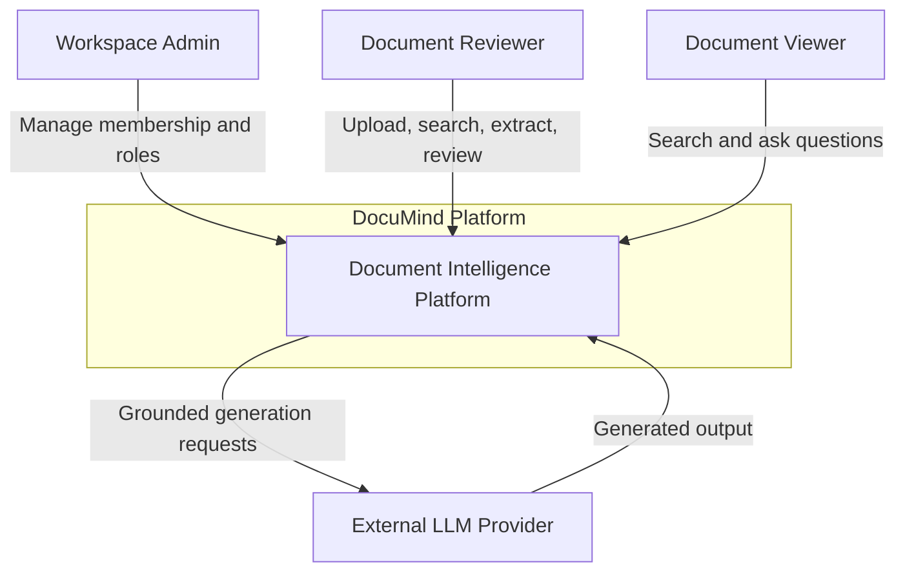
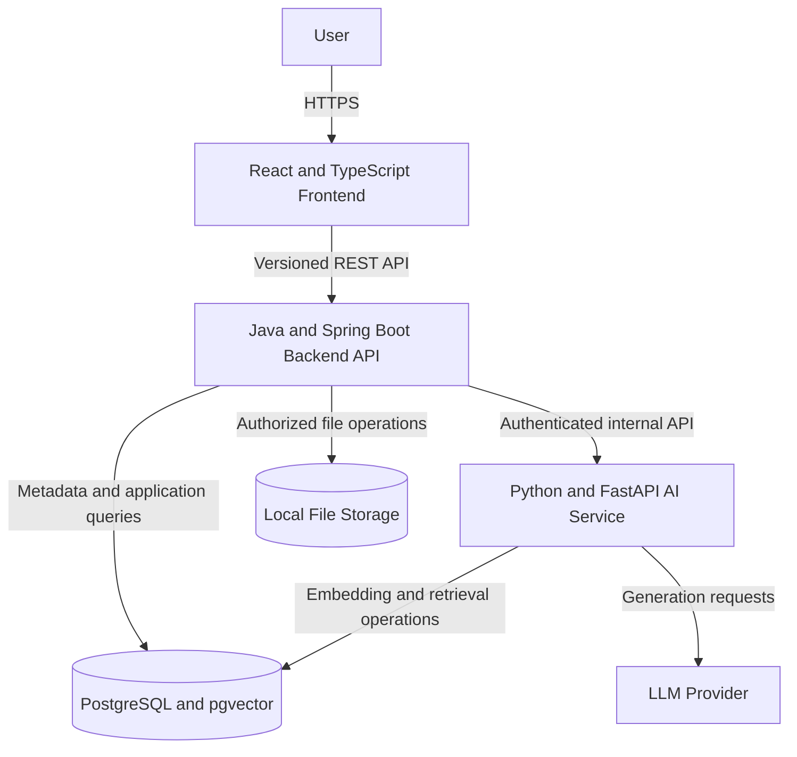
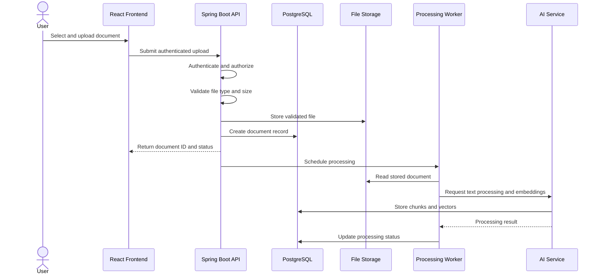
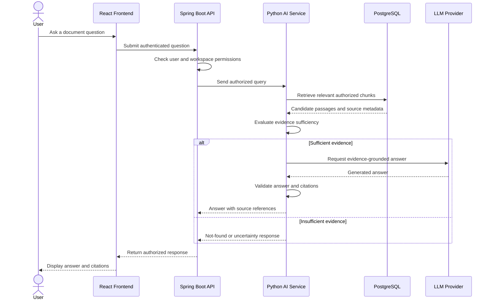
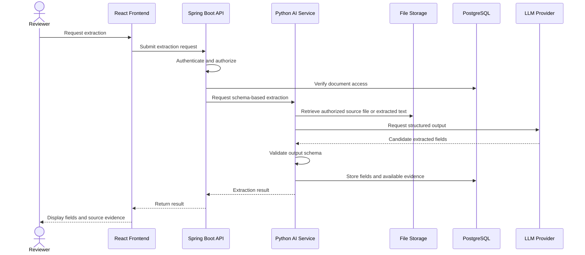
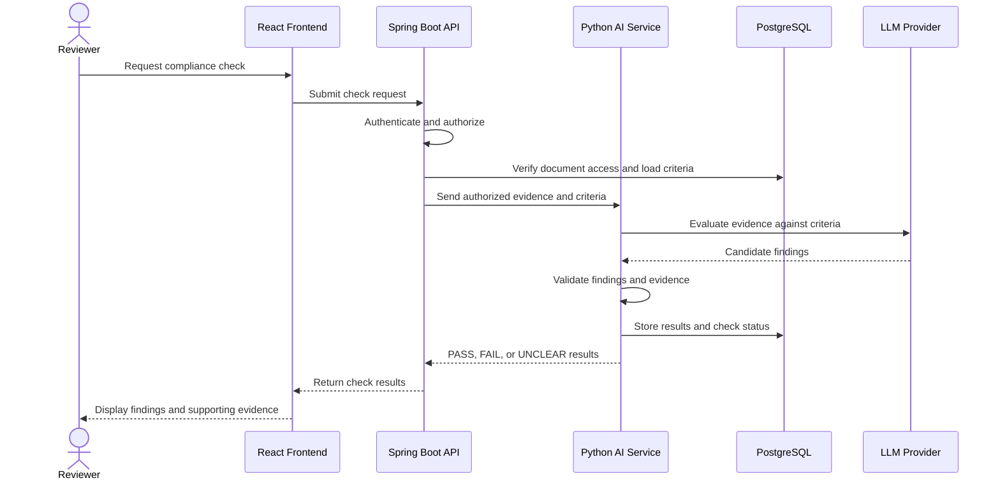

# DocuMind — Architecture Diagrams

**Status:** Proposed architecture  
**Last updated:** 2026-10-20

These diagrams describe the planned system. They are not evidence that the services have been implemented.

## 1. System Context

Shows the people who use DocuMind and the external systems it may depend on.

## 2. Container Architecture

Shows the planned major application components and their responsibilities.

## 3. Sequence: Document Upload and Processing

## 4. Sequence: Question Answering

## 5. Sequence: Structured Extraction

## 6. Sequence: Compliance Check

## 7. Architecture Notes and Open Decisions

- All protected resources require backend authentication and authorization.
- Workspace isolation must apply to document metadata, files, chunks, conversations, extracted fields, and compliance results.
- The exact asynchronous worker or queue mechanism remains undecided.
- The LLM provider remains undecided.
- The file-storage approach is proposed for initial development and may change for deployment.
- The internal AI service must not expose unrestricted public endpoints.
- Processing failures, timeouts, retries, and duplicate processing require explicit handling.
- Citation references must correspond to actual stored evidence.
- These diagrams must be updated when accepted ADRs or implementation details change.
