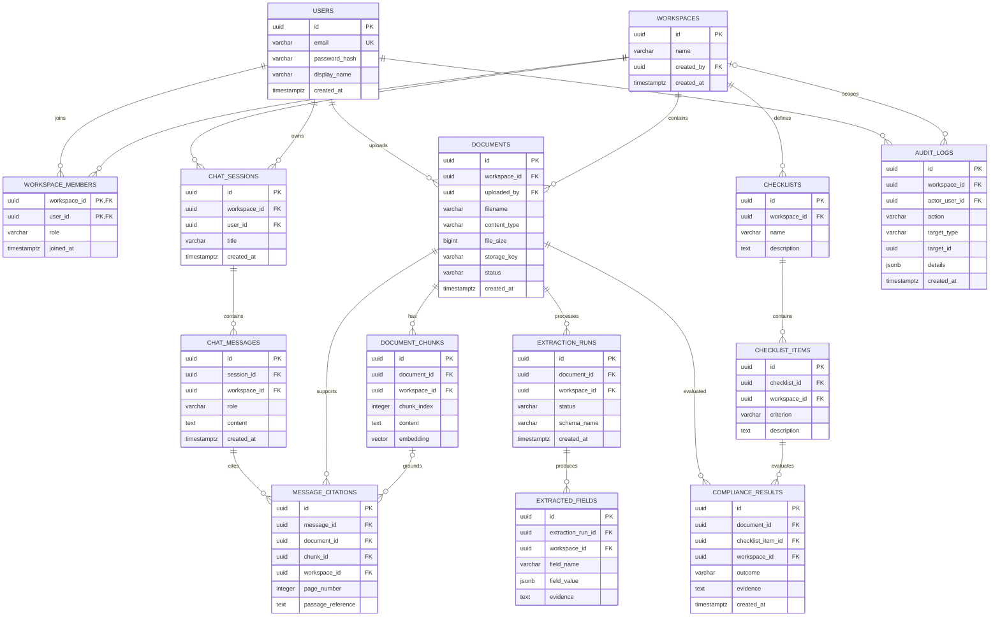

# DocuMind — Database Design

**Status:** Proposed schema  
**Database:** PostgreSQL 17 with pgvector  
**Migration tool:** Flyway

This is a design artifact only. It has not yet been applied to a database. The SQL requires the pgvector extension, which is not currently available in the local PostgreSQL installation.

## 1. Entity-Relationship Diagram

## 2. Entity Responsibilities

| Entity | Responsibility |
|---|---|
| users | User identity and password hash |
| workspaces | Tenant or team boundary |
| workspace_members | Membership and workspace role |
| documents | Uploaded document metadata and processing status |
| document_chunks | Extracted text and vector embeddings |
| chat_sessions | Workspace-scoped question-answering sessions |
| chat_messages | User questions and assistant responses |
| message_citations | Source document and optional chunk references |
| extraction_runs | Structured extraction execution and status |
| extracted_fields | Extracted values and evidence |
| checklists | Workspace compliance definitions |
| checklist_items | Individual checklist criteria |
| compliance_results | Evaluation outcomes and evidence |
| audit_logs | Security and operational events |

## 3. Important Design Rules

- Workspace-owned relationships use composite foreign keys where appropriate to prevent cross-workspace references.
- Backend authorization remains mandatory for every protected operation; foreign keys do not replace authorization.
- Chat sessions must belong to a workspace member.
- Citation records must refer to a message and document in the same workspace.
- Extracted fields must belong to an extraction run in the same workspace.
- Compliance results must evaluate a document and checklist item from the same workspace.
- Embedding dimensions must match the selected embedding model.
- Status values, roles, and numeric ranges are constrained in the schema.
- Passwords are stored as hashes; secrets must not be placed in audit details.
- File retention, deletion policy, row-level security, and vector index configuration require further review.

## 4. Open Decisions

- Install and validate a compatible pgvector extension for PostgreSQL 17.
- Confirm the embedding model and vector index strategy.
- Decide whether UUID generation is performed by the application or database.
- Specify file retention and deletion behavior.
- Review database constraints against API authorization and security requirements.
- Convert the approved schema into versioned Flyway migrations before implementation.
