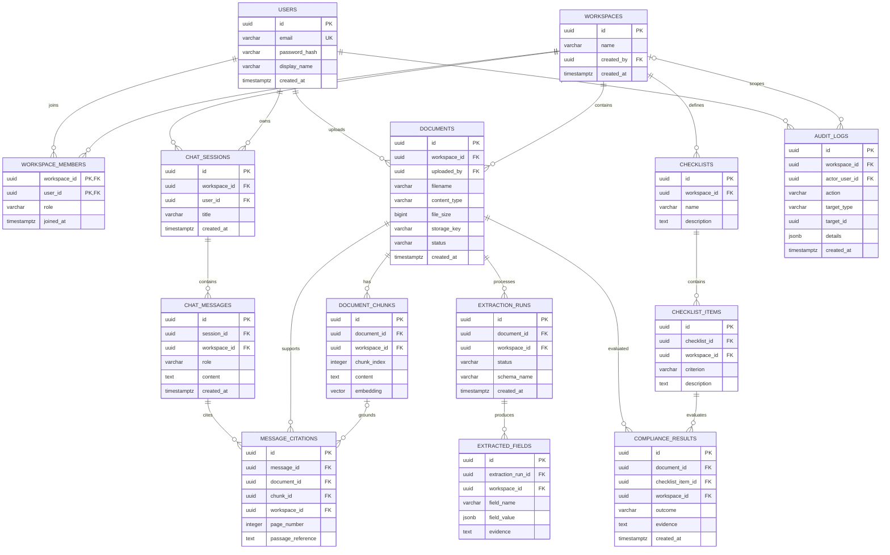

# DocuMind — Database Design

**Status:** Initial schema applied; design subject to further review
**Database:** PostgreSQL 17 with pgvector
**Migration tool:** Flyway

The initial database schema has been applied successfully using Flyway migration V1 (`V1__initial_schema.sql`).

The local PostgreSQL 17 database runs through Docker using the `pgvector/pgvector:pg17` image. The Flyway history confirms that migration V1 completed successfully.

The database currently contains 16 application tables, in addition to Flyway's `flyway_schema_history` table. The `document_chunks.embedding` column uses `VECTOR(384)`, matching the dimensions of the current BGE-small embedding model candidate. Final model approval remains subject to evaluation.

## 1. Entity-Relationship Diagram

## 2. Entity Responsibilities

| Entity | Responsibility |
|---|---|
| users | User identity and password hash |
| workspaces | Tenant or team boundary |
| workspace_members | Membership and workspace role |
| documents | Uploaded document metadata and processing status |
| document_chunks | Extracted text and vector embeddings |
| chat_sessions | Workspace-scoped question-answering sessions |
| chat_messages | User questions and assistant responses |
| message_citations | Source document and optional chunk references |
| extraction_runs | Structured extraction execution and status |
| extracted_fields | Extracted values and evidence |
| checklists | Workspace compliance definitions |
| checklist_items | Individual checklist criteria |
| compliance_results | Evaluation outcomes and evidence |
| audit_logs | Security and operational events |

## 3. Important Design Rules

- Workspace-owned relationships use composite foreign keys where appropriate to prevent cross-workspace references.
- Backend authorization remains mandatory for every protected operation; foreign keys do not replace authorization.
- Chat sessions must belong to a workspace member.
- Citation records must refer to a message and document in the same workspace.
- Extracted fields must belong to an extraction run in the same workspace.
- Compliance results must evaluate a document and checklist item from the same workspace.
- Embedding dimensions must match the selected embedding model.
- Status values, roles, and numeric ranges are constrained in the schema.
- Passwords are stored as hashes; secrets must not be placed in audit details.
- File retention, deletion policy, row-level security, and vector index configuration require further review.

## 4. Open Decisions

- Install and validate a compatible pgvector extension for PostgreSQL 17.
- Confirm the embedding model and vector index strategy.
- Decide whether UUID generation is performed by the application or database.
- Specify file retention and deletion behavior.
- Review database constraints against API authorization and security requirements.
- Continue evolving the database schema through versioned Flyway migrations. Do not modify migrations that have already been applied.
